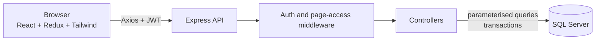

# NIS Security Management Dashboard

**Neha Industrial Security (NIS)** – a full-stack workforce management system for security agencies. It replaces the paper register with one web application for guards, clients, sites, contractors, deployments, daily attendance, monthly payroll and reports.

      

---

## 📑 Table of Contents

1. [Overview](#-overview)
2. [Features](#-features)
3. [User Roles and Page Access](#-user-roles-and-page-access)
4. [Technology Stack](#-technology-stack)
5. [Architecture](#-architecture)
6. [Project Structure](#-project-structure)
7. [Getting Started](#-getting-started)
8. [Environment Variables](#-environment-variables)
9. [Business Rules](#-business-rules)
10. [Database Overview](#-database-overview)
11. [API Reference](#-api-reference)
12. [Security](#-security)
13. [Deployment Notes](#-deployment-notes)
14. [Troubleshooting](#-troubleshooting)
15. [Roadmap](#-roadmap)
16. [License](#-license)

---

## 📌 Overview

Running a security agency means answering the same questions every day: _Which guard is posted where? Who came to duty today? How much salary is due this month?_

The NIS dashboard answers these from a single place:

- **Every guard** has a complete profile (identity, bank, PF/ESI, salary, contractor) and a full posting history.
- **Every client and site** shows how many guards are required and how many are deployed.
- **Attendance** is marked per site, per day, in about a minute.
- **Payroll** is calculated automatically from attendance, with PF, ESI, overtime and deductions.
- **Access is controlled**: an Admin decides which pages each type of user can see.

---

## ✨ Features

### 1. Authentication and Account

- JWT login with bcrypt-hashed passwords.
- **Change password** from the sidebar (current password, new password, confirmation).
- Login rate limiting.
- Accounts can be deactivated and are blocked immediately on the server.

### 2. Dashboard

- Guards on duty, guards not assigned to any site, clients, sites and contractors.
- Today's attendance split into Present, Absent, Half day, Leave and Weekly off.
- Current month payroll: total, paid and pending (Admin only).
- Sites short of guards and guards per client.

### 3. Guard Management

- Add, edit, search, filter and deactivate guards.
- Automatic unique guard code (`NSG-0001`, `NSG-0002`, …).
- Personal details, Aadhaar, PAN, UAN, ESIC, bank account, PF/ESI applicability, salary, joining date, contractor and emergency contact.
- Guard profile page with posting history and recent salary (Admin).
- Filters: status, contractor, client and "not assigned to a site".

### 4. Client, Site and Contractor Management

- **Clients:** company, contact person, GST, address and contract dates, with site and guard counts.
- **Sites:** linked to a client, with required guard count, supervisor and a "short by N" warning.
- **Contractors:** agency details, PAN, licence number and guard count.
- Soft delete (deactivate) keeps history intact.

### 5. Deployments

- Assign a guard to a site with a Day, Night or General shift.
- **Transfer** closes the old posting automatically the day before the new one starts.
- End a deployment and keep the complete history.

### 6. Attendance

- Site-wise daily sheet with one-tap status buttons: `P`, `A`, `HD`, `L`, `WO`.
- Overtime hours per guard and bulk save.
- Monthly summary per guard with payable days, exportable to CSV.
- Future dates cannot be marked and a month is **locked** once a guard's salary is paid.

### 7. Payroll _(Admin; viewable by other roles only if Admin allows)_

- Generate payroll for any month from attendance.
- Overtime, PF and ESI calculation, advance and other deductions, net pay.
- Mark as paid with payment mode, date and reference number.
- Paid records can never be changed; pending rows can be regenerated safely.
- CSV export with bank details for salary transfers.

### 8. Reports

- Guard deployment report: guard, company, site, shift, start date and contractor.
- "Not assigned" view and CSV export.

### 9. Administration _(Admin only)_

- **Users:** create users, choose their role, reset passwords, deactivate accounts.
- **Page Access:** a table where the Admin ticks which pages Supervisors and End Users can see.

### 10. User Interface

- Collapsible sidebar (full or icon-only) that remembers your choice, and a slide-out menu on mobile.
- Pop-up windows that always appear on top, with a blue backdrop.
- Toast notifications for every success and error.

---

## 👥 User Roles and Page Access

There are three roles.

| Capability                             | Admin |       Supervisor        |        End User         |
| -------------------------------------- | :---: | :---------------------: | :---------------------: |
| See every page                         |  ✅   | Only pages Admin allows | Only pages Admin allows |
| Add, edit, deactivate records          |  ✅   |           ❌            |           ❌            |
| Mark attendance                        |  ✅   |           ✅            |     ❌ (view only)      |
| See salary and bank details            |  ✅   |           ❌            |           ❌            |
| Generate payroll, pay, edit deductions |  ✅   |           ❌            |           ❌            |
| Manage users and page access           |  ✅   |           ❌            |           ❌            |
| Change own password                    |  ✅   |           ✅            |           ✅            |

**Default page access** (Admin can change this any time in _Page Access_):

| Page        | Supervisor | End User |
| ----------- | :--------: | :------: |
| Dashboard   |     ✅     |    ✅    |
| Guards      |     ✅     |    ❌    |
| Deployments |     ✅     |    ❌    |
| Attendance  |     ✅     |    ❌    |
| Payroll     |     ❌     |    ❌    |
| Clients     |     ❌     |    ❌    |
| Sites       |     ✅     |    ❌    |
| Contractors |     ❌     |    ❌    |
| Reports     |     ✅     |    ✅    |

> Page access is enforced **on the server as well as in the menu**. A user who types the address of a hidden page is redirected, and the API rejects the request. If Admin ticks _Payroll_ for a role, that role can view payroll amounts (read-only); only Admin can change payroll. Changes apply on the user's next action and the menu updates after a page refresh.

---

## 🛠️ Technology Stack

### Frontend

| Technology                  | Purpose                                      |
| --------------------------- | -------------------------------------------- |
| React 18 + Vite             | UI and build tooling                         |
| Tailwind CSS 3              | Styling                                      |
| Redux Toolkit + React Redux | State management                             |
| React Router 6              | Routing and page protection                  |
| Axios                       | API client with token and error interceptors |
| React-Toastify              | Notifications                                |
| lucide-react                | Icons                                        |

### Backend

| Technology                               | Purpose                                                   |
| ---------------------------------------- | --------------------------------------------------------- |
| Node.js 18+ (ES Modules)                 | Runtime                                                   |
| Express 4                                | Web framework                                             |
| mssql (tedious)                          | SQL Server driver, parameterised queries and transactions |
| jsonwebtoken, bcryptjs                   | Authentication and password hashing                       |
| express-validator                        | Request validation                                        |
| helmet, cors, express-rate-limit, morgan | Security headers, CORS, rate limiting, logging            |
| dotenv, nodemon                          | Configuration and development reload                      |

### Database

- Microsoft SQL Server (Express edition is enough for this workload).

---

## 🏗️ Architecture



Key design points:

- **Config-driven CRUD.** Guards, clients, sites and contractors share one CRUD factory on the server (`utils/crudFactory.js`) and one `CrudPage` component on the client, so a new master list needs very little code.
- **Role is read from the database on every request**, so a role change or deactivation takes effect immediately.
- **Soft deletes.** Records are marked inactive instead of being deleted, so history and payroll stay correct.
- **Redux state is cleared on sign out**, so the next person never sees the previous person's data.

---

## 📂 Project Structure

```text
NIS-Dashboard/
├── client/                         # React application (Vite)
│   ├── src/
│   │   ├── app/                    # Redux store
│   │   ├── components/             # Layout, CrudPage, ui, route guards, password modal
│   │   ├── features/               # Redux slices (auth, guards, payroll, access, ...)
│   │   ├── pages/                  # One file per screen
│   │   ├── services/               # Axios instance and interceptors
│   │   ├── utils/                  # Date, currency and CSV helpers
│   │   ├── App.jsx                 # Routes
│   │   └── main.jsx
│   ├── .env                        # Not committed
│   └── package.json
│
├── server/                         # Express API (ES Modules)
│   ├── src/
│   │   ├── config/                 # db.js (connection pool), pages.js (page keys)
│   │   ├── controllers/            # auth, guard, client, site, contractor, deployment,
│   │   │                           # attendance, payroll, dashboard, report, user, access
│   │   ├── middleware/             # auth.js (login, roles, page access), validate.js, error.js
│   │   ├── routes/                 # index.js (all routes)
│   │   ├── utils/                  # ApiError, asyncHandler, crudFactory, dates, pagination, access
│   │   ├── app.js
│   │   └── server.js
│   ├── scripts/                    # One-time helpers (not committed)
│   ├── .env                        # Not committed
│   └── package.json
│
└── README.md
```

> `database/` (SQL scripts), `scripts/` and every `.env` file are listed in `.gitignore` and are **not** in the repository. Keep a private backup of your SQL scripts.

---

## 🚀 Getting Started

### Prerequisites

- Node.js 18 or newer and npm
- Microsoft SQL Server (Express is fine) and SQL Server Management Studio (SSMS)
- Git

### 1. Clone

```bash
git clone YOUR_REPOSITORY_URL
cd NIS-Dashboard
```

### 2. Set up the database

1. In SSMS, connect with an **administrator** login (Windows Authentication works for most local installs).
2. Create the database and a dedicated login for the app:
   ```sql
   CREATE DATABASE NIS_Security;
   GO
   CREATE LOGIN nis_appuser WITH PASSWORD = 'ChooseAStrongPassword!', CHECK_POLICY = OFF;
   GO
   USE NIS_Security;
   GO
   CREATE USER nis_appuser FOR LOGIN nis_appuser;
   ALTER ROLE db_owner ADD MEMBER nis_appuser;
   GO
   ```
3. Select **NIS_Security** in the toolbar and run your schema script. It must create these tables: `Users`, `Contractors`, `Clients`, `Sites`, `Guards`, `Deployments`, `Attendance`, `Payments` and `RolePages` (see [Database Overview](#-database-overview)).
4. Allow SQL logins and TCP connections (Node connects over TCP):
   - SSMS: server **Properties → Security → SQL Server and Windows Authentication mode**.
   - **SQL Server Configuration Manager → SQL Server Network Configuration → Protocols → TCP/IP → Enable**. Under **IPAll** clear _TCP Dynamic Ports_ and set _TCP Port_ to `1433`.
   - Restart the SQL Server service.
5. Check the port: `Test-NetConnection localhost -Port 1433` should show `TcpTestSucceeded : True`.

### 3. Backend

```bash
cd server
npm install
```

Create `server/.env` (see [Environment Variables](#-environment-variables)), then create the first Admin login:

```bash
npm run seed:admin
```

The script asks for a username and password. If you do not have `scripts/seedAdmin.js` (it is not in Git), create the admin from SQL instead:

```bash
# 1. make a password hash (run inside the server folder)
node --input-type=module -e "import b from 'bcryptjs'; console.log(b.hashSync('YourStrongPassword', 10))"
```

```sql
-- 2. paste the hash into this statement
INSERT INTO dbo.Users (FullName, Username, PasswordHash, Role)
VALUES (N'Administrator', 'admin', '<paste hash here>', 'Admin');
```

Start the API:

```bash
npm run dev
```

Check `http://localhost:5000/api/health`; it should return `{"status":"ok"}`.

### 4. Frontend

```bash
cd client
npm install
```

Create `client/.env`, then:

```bash
npm run dev
```

Open `http://localhost:5173` and sign in with the Admin account.

### 5. First-time data entry order

Enter data in this order, because each step depends on the previous one:

1. **Contractors**
2. **Clients**
3. **Sites** (with guards required)
4. **Guards**
5. **Deployments** (assign each guard to a site)
6. **Users** (create Supervisor and End User logins) and **Page Access**

After that, daily work is attendance, and month end is payroll.

### NPM scripts

| Folder   | Command              | Purpose                                  |
| -------- | -------------------- | ---------------------------------------- |
| `server` | `npm run dev`        | Start the API with auto-reload (nodemon) |
| `server` | `npm start`          | Start the API normally (production)      |
| `server` | `npm run seed:admin` | Create or reset the Admin login          |
| `client` | `npm run dev`        | Start the Vite development server        |
| `client` | `npm run build`      | Create the production build in `dist/`   |
| `client` | `npm run preview`    | Preview the production build locally     |

---

## 🔧 Environment Variables

### Backend – `server/.env`

```dotenv
PORT=5000
NODE_ENV=development
CLIENT_URL=http://localhost:5173

DB_SERVER=localhost
DB_PORT=1433
DB_NAME=NIS_Security
DB_USER=nis_appuser
DB_PASSWORD=your_database_password
DB_ENCRYPT=false
DB_TRUST_CERT=true

ADMIN_USER=admin
ADMIN_PASSWORD=
JWT_SECRET=your_long_random_secret
JWT_EXPIRES_IN=12h
```

| Variable                        | Description                                                                                                                                                                    |
| ------------------------------- | ------------------------------------------------------------------------------------------------------------------------------------------------------------------------------ |
| `PORT`                          | Port the API listens on (default `5000`).                                                                                                                                      |
| `NODE_ENV`                      | `development` or `production`. In production, internal error details are hidden from responses.                                                                                |
| `CLIENT_URL`                    | Exact URL of the frontend. Used for CORS, so it must match the browser address.                                                                                                |
| `DB_SERVER`                     | SQL Server host, e.g. `localhost`.                                                                                                                                             |
| `DB_PORT`                       | SQL Server TCP port (default `1433`).                                                                                                                                          |
| `DB_NAME`                       | Database name.                                                                                                                                                                 |
| `DB_USER` / `DB_PASSWORD`       | SQL login used by the app (not Windows authentication).                                                                                                                        |
| `DB_ENCRYPT`                    | `true` for Azure SQL or encrypted servers, `false` for local SQL Express.                                                                                                      |
| `DB_TRUST_CERT`                 | `true` to accept a self-signed server certificate (typical for local installs).                                                                                                |
| `ADMIN_USER` / `ADMIN_PASSWORD` | Optional. Only used by a seed script that reads them. The seed script described above asks interactively, so these can stay empty. Do not keep a real password here long-term. |
| `JWT_SECRET`                    | Long random text used to sign tokens. Keep it secret and unique per environment.                                                                                               |
| `JWT_EXPIRES_IN`                | Token lifetime, e.g. `12h`.                                                                                                                                                    |

Generate a strong secret:

```bash
node -e "console.log(require('crypto').randomBytes(48).toString('hex'))"
```

### Frontend – `client/.env`

```dotenv
VITE_API_URL=http://localhost:5000/api

VITE_TOKEN_KEY=nis_token
VITE_USER_KEY=nis_user
```

| Variable         | Description                                                                       |
| ---------------- | --------------------------------------------------------------------------------- |
| `VITE_API_URL`   | Base URL of the API, including `/api`.                                            |
| `VITE_TOKEN_KEY` | Name of the browser `localStorage` entry that holds the login token.              |
| `VITE_USER_KEY`  | Name of the browser `localStorage` entry that holds the signed-in user's profile. |

> Vite reads `.env` only at start-up, so **restart `npm run dev` after any change**. Variables must start with `VITE_` to reach the browser, and they are visible to anyone using the site, so never put secrets in the frontend `.env`.

---

## 📐 Business Rules

### Attendance statuses

| Code | Meaning    | Counts as |
| ---- | ---------- | --------- |
| `P`  | Present    | 1 day     |
| `HD` | Half day   | 0.5 day   |
| `L`  | Paid leave | 1 day     |
| `WO` | Weekly off | 1 day     |
| `A`  | Absent     | 0 day     |

- Attendance cannot be marked for a future date.
- Attendance for a month is locked for any guard whose salary for that month is **Paid**.
- A guard appears on a site's sheet only if a deployment covers that date.

### Payroll calculation

| Item            | Rule                                                                         |
| --------------- | ---------------------------------------------------------------------------- |
| Daily rate      | Monthly salary ÷ days in the month                                           |
| Payable days    | Present + 0.5 × Half day + Paid leave + Weekly off (capped at days in month) |
| Earned amount   | Daily rate × payable days                                                    |
| Overtime amount | Overtime hours × (daily rate ÷ 8) × 2                                        |
| Gross           | Earned + overtime                                                            |
| PF              | 12% of earned amount, if the guard has PF                                    |
| ESI             | 0.75% of gross, if the guard has ESI and monthly salary ≤ ₹21,000            |
| Net pay         | Gross − PF − ESI − advance − other deductions (never below 0)                |

These constants live at the top of `server/src/controllers/payroll.controller.js`. Regenerating payroll refreshes pending rows and keeps advances and other deductions you entered; **paid rows are never changed**.

### Deployments

- A guard has at most one active posting.
- Assigning a guard to a new site closes the current posting automatically.
- Ended postings stay in the guard's history.

---

## 🗄️ Database Overview

| Table         | Purpose                                                                                      |
| ------------- | -------------------------------------------------------------------------------------------- |
| `Users`       | App logins: name, username, password hash, role (`Admin`, `Supervisor`, `User`), active flag |
| `RolePages`   | Which pages each role can see (one row per role and page)                                    |
| `Contractors` | Agencies that supply guards                                                                  |
| `Clients`     | Client companies and contract information                                                    |
| `Sites`       | Client locations with required guard count                                                   |
| `Guards`      | Guard profiles, identity, bank, PF/ESI, salary, contractor                                   |
| `Deployments` | Guard postings with shift, start date, end date, active flag                                 |
| `Attendance`  | One row per guard per day (unique), status, overtime, who marked it                          |
| `Payments`    | One row per guard per month (unique), calculated amounts and payment status                  |

Relationships: `Clients 1─* Sites`, `Contractors 1─* Guards`, `Guards 1─* Deployments *─1 Sites`, `Guards 1─* Attendance`, `Guards 1─* Payments`.

The SQL scripts are kept out of the repository. Store a private copy of your schema script and the roles/page-access migration.

---

## 🔗 API Reference

Base URL: `http://localhost:5000/api`. All routes except `/health` and `/auth/login` need the header `Authorization: Bearer <token>`.

**Read access** to a data route needs access to the page that uses it (for example the Deployments page also needs the guard list). **Write access** is Admin only unless noted.

### Public

| Method | Endpoint      | Description                                    |
| ------ | ------------- | ---------------------------------------------- |
| GET    | `/health`     | Health check                                   |
| POST   | `/auth/login` | Sign in, returns token, user and allowed pages |

### Account

| Method | Endpoint                | Description                                            |
| ------ | ----------------------- | ------------------------------------------------------ |
| GET    | `/auth/me`              | Current user, role and allowed pages                   |
| POST   | `/auth/change-password` | Change own password (`currentPassword`, `newPassword`) |

### Master data (guards, clients, sites, contractors)

| Method | Endpoint                                        | Access         | Description                                    |
| ------ | ----------------------------------------------- | -------------- | ---------------------------------------------- |
| GET    | `/guards`, `/clients`, `/sites`, `/contractors` | By page access | Paginated list with `search`, filters, `all=1` |
| GET    | `/{resource}/:id`                               | By page access | One record (`/guards/:id` includes history)    |
| POST   | `/{resource}`                                   | Admin          | Create                                         |
| PUT    | `/{resource}/:id`                               | Admin          | Update                                         |
| DELETE | `/{resource}/:id`                               | Admin          | Deactivate (soft delete)                       |

### Operations

| Method | Endpoint                    | Access            | Description                                           |
| ------ | --------------------------- | ----------------- | ----------------------------------------------------- |
| GET    | `/dashboard`                | Page access       | Dashboard statistics (payroll figures for Admin only) |
| GET    | `/deployments`              | Page access       | Active deployments                                    |
| POST   | `/deployments`              | Admin             | Assign or transfer a guard                            |
| PUT    | `/deployments/:id/end`      | Admin             | End a deployment                                      |
| GET    | `/attendance/sheet`         | Page access       | Guards at a site for a date (`date`, `siteId`)        |
| GET    | `/attendance/summary`       | Page access       | Monthly totals (`month`, `year`)                      |
| POST   | `/attendance/bulk`          | Admin, Supervisor | Save attendance for a site and date                   |
| GET    | `/payroll`                  | Page access       | Payroll for a month (`month`, `year`)                 |
| POST   | `/payroll/generate`         | Admin             | Generate payroll for a month                          |
| PUT    | `/payroll/:id`              | Admin             | Update advance and other deductions                   |
| PATCH  | `/payroll/:id/pay`          | Admin             | Mark as paid                                          |
| GET    | `/reports/guard-deployment` | Page access       | Guard deployment report                               |

### Administration (Admin only)

| Method | Endpoint                    | Description                   |
| ------ | --------------------------- | ----------------------------- |
| GET    | `/users`                    | List users                    |
| POST   | `/users`                    | Create a user                 |
| PUT    | `/users/:id`                | Update name, role or status   |
| DELETE | `/users/:id`                | Deactivate a user             |
| POST   | `/users/:id/reset-password` | Set a new password for a user |
| GET    | `/access`                   | Get the page-access table     |
| PUT    | `/access`                   | Save the page-access table    |

Errors return JSON: `{ "message": "...", "details": [...] }` with a suitable status code (`401` not signed in, `403` not allowed, `404` not found, `409` duplicate or linked record, `422` validation).

---

## 🛡️ Security

- JWT authentication; the account's active status and role are checked in the database on every request.
- bcrypt password hashing; minimum 8 characters for new passwords.
- Role and page-access rules enforced on the server; salary and bank data removed from responses for non-Admins.
- Parameterised SQL everywhere and transactions for multi-step changes.
- `helmet` security headers, restricted CORS (`CLIENT_URL`) and login rate limiting (30 attempts per 15 minutes per address).
- Requests validated with `express-validator` and centralised error handling.
- Admin safety rules: the last active Admin cannot be deactivated or demoted, and you cannot remove your own Admin access.
- Secrets live in `.env` files that are excluded from Git.

---

## 🌐 Deployment Notes

A small cloud server is recommended over an office PC: supervisors can mark attendance from the site, and backups and uptime are easier.

1. **Build the client:** `cd client && npm run build`, then serve `client/dist` with a web server (Nginx, IIS or similar).
2. **Run the API** with a process manager such as PM2 so it restarts after a reboot: `NODE_ENV=production`.
3. **Use HTTPS** with a domain name and set `CLIENT_URL` to the real site address. Set `VITE_API_URL` to the real API address _before_ building.
4. **Never expose port 1433** (SQL Server) to the internet; only the API server should reach the database.
5. Use a strong `JWT_SECRET`, a strong database password and a changed Admin password.
6. Schedule **daily database backups** and test a restore.
7. Give each staff member their own login and use the Supervisor or End User role for field staff.

---

## 🩺 Troubleshooting

| Problem                                                 | Likely cause and fix                                                                                                                          |
| ------------------------------------------------------- | --------------------------------------------------------------------------------------------------------------------------------------------- |
| `ECONNREFUSED` or _Failed to connect to localhost:1433_ | TCP/IP is off or the port is not 1433. Enable TCP/IP, set the port, restart SQL Server, then check `Test-NetConnection localhost -Port 1433`. |
| `Login failed for user '...'`                           | Wrong password in `.env`, or mixed-mode authentication is not enabled.                                                                        |
| Certificate or encryption error                         | Set `DB_ENCRYPT=true` and keep `DB_TRUST_CERT=true`.                                                                                          |
| `Invalid object name 'RolePages'`                       | The page-access table was not created. Run the roles and page-access migration on the application database.                                   |
| `CREATE DATABASE permission denied`                     | You are connected as the app login. Connect as an administrator for setup.                                                                    |
| `Attendance is locked`                                  | A guard's salary for that month is marked Paid. Reopen the payment only if it was a test (see payroll notes above).                           |
| CORS error in the browser                               | `CLIENT_URL` does not match the address in the browser. Restart the API after changing it.                                                    |
| Changes to `.env` ignored                               | Restart the server (`npm run dev`) or the Vite dev server.                                                                                    |
| User sees an old menu                                   | Page access changes show after a page refresh; the API enforces them immediately.                                                             |

---

## 🚀 Roadmap

- Excel and PDF exports and salary slips
- Bulk guard import from Excel
- Guard photographs and document uploads
- Client invoicing and billing
- Advance tracking across months
- Per-user page access (beyond per-role)
- Audit log of who changed what
- SMS and WhatsApp notifications
- GPS or photo-based attendance
- Advanced dashboard charts and multi-branch support
- Automated database backups

---

## 📄 License

This project is developed for NIS (Neha Industrial Security). All rights reserved.

---

**NIS Security Management Dashboard** – _Guards · Sites · Attendance · Payroll · Reports_
